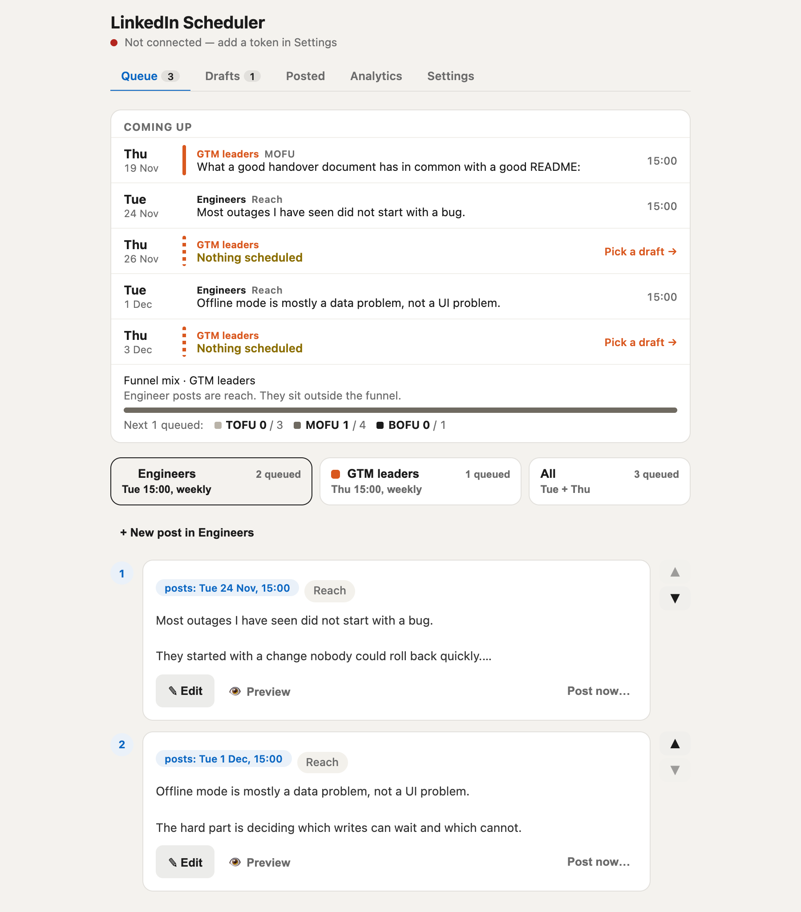
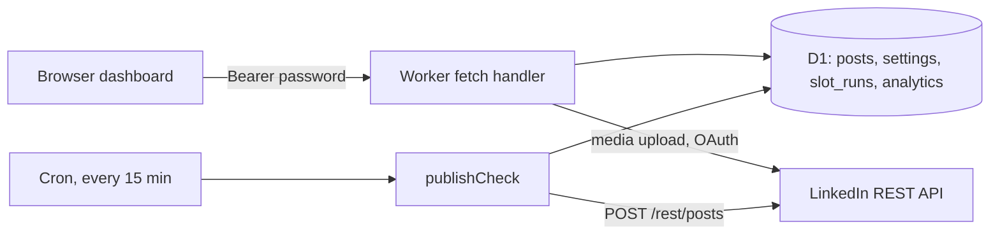

# LinkedIn Scheduler

[](https://github.com/alexbancu/linkedin-scheduler/actions/workflows/ci.yml)
[](LICENSE)

Write LinkedIn posts, approve them, and let a Cloudflare Worker publish them on fixed weekly slots through the official LinkedIn API.

I built it for my own posting and have used it since July 2026. It has published 19 of my posts so far. This repository is a cleaned copy of that app. The code is the same, and the parts that only made sense for me are removed.



## What it does

- **Two queues, each with its own weekly slot.** For example Tuesdays and Thursdays at 15:00. A post waits in its queue until the next free slot.
- **Text, photos, PDF carousels and video.** Files stream through the Worker to LinkedIn's media API when you attach them, so only the asset ID is stored.
- **A feed preview** that shows where LinkedIn cuts the post with "see more", on mobile and on desktop.
- **Safety checks before anything goes out.** A post that still has `[placeholder]` text is never published by the scheduler, and two posts are never published within 24 hours of each other.
- **Analytics.** Import LinkedIn's creator analytics export (.xlsx) and see impressions, engagement and audience per post, next to your usual numbers.
- **LinkedIn connect inside the app.** The OAuth flow runs in the Worker, so renewing the 60-day token takes one click.

## Architecture



| File | Role |
| --- | --- |
| `src/index.ts` | Routes requests, sign-in, and the cron |
| `src/auth.ts` | Session cookies, password checks, rate limits |
| `src/publish.ts` | Decides whether to publish now and claims the slot |
| `src/schedule.ts` | Slot math in Europe/Bucharest. Pure functions, DST aware |
| `src/linkedin.ts` | LinkedIn API: publish, streamed image and PDF upload, chunked video upload |
| `src/crypto.ts` | AES-256-GCM encryption of the LinkedIn token |
| `src/api.ts`, `src/analytics.ts` | JSON API for the dashboard |
| `src/dashboard/` | The dashboard: one HTML file and one script, no build step |
| `migrations/` | D1 schema |

## Design decisions

**A slot can publish only once.** Cron runs can overlap, and a retry after a timeout must not post twice. Each publish first inserts a row keyed on queue plus local date into `slot_runs` (`ON CONFLICT DO NOTHING`), and moves the post to `publishing` in the same D1 batch. Only the run that wins both writes calls LinkedIn. The test `never publishes twice for one slot, even when cron runs overlap` runs three checks at once and expects one API call.

**A failed post is not retried by itself.** If LinkedIn rejects a post, it is marked `failed` with LinkedIn's answer and waits for a person. An automatic retry could publish a post the author no longer wants, at a time they did not pick.

**Slots follow local time, not UTC.** The slot is "Tuesday 15:00 in Bucharest". The code converts with `Intl` for each date, so the post goes out at 15:00 on both sides of a daylight saving change. The tests pin both changes in 2026.

**Media is streamed, not stored.** Files go from the browser through the Worker to LinkedIn without being fully buffered. Video is uploaded in 4 MB parts. The app stores only the asset URN, so there is no blob storage to secure or pay for.

**No framework.** The Worker uses only the platform APIs (fetch, Web Crypto, D1), and the dashboard is plain JavaScript. There are no runtime dependencies to keep up to date.

## Security

- **Sign-in:** the dashboard sends the password once to `/api/login` and gets a signed session cookie back (HMAC-SHA256, 7 days, `HttpOnly; Secure; SameSite=Strict`). The browser never stores the password, and page scripts cannot read the cookie. Changing `DASH_PASSWORD` signs every session out.
- **Scripts:** can send the password as a Bearer token instead. It is compared in constant time with `crypto.subtle.timingSafeEqual`.
- **Brute force:** password checks are rate limited per IP with the Workers rate limiting binding: 5 logins and 60 Bearer calls a minute. Use a long random password, for example `openssl rand -base64 24`.
- **CSRF:** besides `SameSite=Strict`, every write made with the cookie must come with an `Origin` header from the app's own origin.
- **LinkedIn token:** encrypted at rest with AES-256-GCM (a 32-byte key in a Worker secret, checked at startup). The API never returns it, only whether it is set and how old it is.
- **OAuth:** the `state` value is random, single use and valid for 10 minutes. It must match both the copy in D1 and a cookie in the browser that started the sign-in, so a forged callback is ignored and cannot cancel a real one. Text from the callback's query string is never shown on the page.
- **Outbound requests:** the access token is only sent to `https` hosts under `linkedin.com`, also when LinkedIn hands back an upload URL. Media URLs passed to the page must be on `licdn.com`.
- **Publishing:** both the scheduler and "Post now" claim the post atomically in D1 before calling LinkedIn, so a double click, a retry or an overlapping cron run cannot post it twice.
- **Headers:** a Content Security Policy that allows scripts only from the app itself (no inline script), plus HSTS, `X-Frame-Options: DENY`, `nosniff`, `no-referrer` and a restrictive `Permissions-Policy`. Inline styles are allowed because the dashboard sets element styles.
- **No HTML injection:** post text is rendered with `textContent`, and every SQL query uses bound parameters.
- **Supply chain:** no runtime dependencies. CI uses a read-only token, pins GitHub Actions to commit SHAs and fails on any high-severity `npm audit` finding. Dependabot opens weekly updates.
- **Secrets:** none are in this repository. Local values go in `.dev.vars`, which git ignores. See [SECURITY.md](SECURITY.md) to report a problem.

## Run it

You need Node.js 20 or newer and a Cloudflare account. The free plan is enough.

```sh
npm install
cp .dev.vars.example .dev.vars        # set DASH_PASSWORD and TOKEN_ENC_KEY
npx wrangler d1 migrations apply linkedin-scheduler --local
npm run dev                           # http://localhost:8787
```

To deploy:

```sh
npx wrangler d1 create linkedin-scheduler   # paste the id into wrangler.jsonc
npx wrangler d1 migrations apply linkedin-scheduler --remote
npx wrangler secret put DASH_PASSWORD       # openssl rand -base64 24
npx wrangler secret put TOKEN_ENC_KEY       # openssl rand -base64 32
npx wrangler secret put LI_CLIENT_SECRET
npm run deploy
```

**LinkedIn app:** create one at [developer.linkedin.com](https://developer.linkedin.com) and add the products "Share on LinkedIn" and "Sign In with LinkedIn using OpenID Connect". Set the redirect URL to `https://<your-worker>/oauth/callback` and put the client ID in `wrangler.jsonc`. Then use **Settings, Connect LinkedIn** in the dashboard.

## Tests

```sh
npm run check    # typecheck, then the tests
```

The tests run inside the Workers runtime through [`@cloudflare/vitest-plugin`](https://developers.cloudflare.com/workers/testing/vitest-integration/), against a real local D1 database built from `migrations/`. LinkedIn is replaced by a stub `fetch`. They cover:

- slot math across both daylight saving changes, and cadence;
- publishing: one post per slot under overlapping runs, the placeholder guard, the minimum gap, and failures;
- token encryption: round trip, a fresh IV each time, rejecting tampered ciphertext and short keys;
- sign-in: session cookies, expired or tampered sessions, cross-origin writes, and the rate limit;
- OAuth: forged callbacks, a state from another browser, and query text that must not be shown;
- the HTTP surface: security headers, the script-only CSP, bad JSON, input checks, and that a token is never returned;
- "Post now" clicked twice at once publishes once.

CI runs the same command on every push.

## API

Sign in with `POST /api/login {password}` (cookie) or send `Authorization: Bearer <DASH_PASSWORD>` on every call.

| Method | Path | Body or query |
| --- | --- | --- |
| POST | `/api/login`, `/api/logout` | `{password}` / none |
| GET | `/api/state` | |
| POST | `/api/posts` | `{text, approve?, queue?, stage?, media?, first_comment?}` |
| PUT | `/api/posts/:id` | `{text?, status?, queue?, stage?, media?, first_comment?}` |
| DELETE | `/api/posts/:id` | |
| POST | `/api/posts/:id/publish` | `{force?}` publishes now, outside the schedule |
| POST | `/api/posts/:id/move` | `{dir: "up" \| "down"}` |
| POST | `/api/posts/:id/comment` | `{text?}` retries the first comment on a live post |
| POST | `/api/settings` | `{queue?, post_day?, post_hour?, cadence_weeks?, min_gap_hours?, stage_target?}` |
| POST | `/api/media` | `?kind=images\|document\|video&name=`, the file bytes |
| GET | `/api/media/video` | `?urn=` LinkedIn's processing status and preview for a video |
| GET | `/api/analytics` | |
| POST | `/api/analytics/import` | the export, parsed in the browser |
| POST | `/api/analytics/page-stats` | `{checked_on, items}` numbers from each post's analytics page |
| POST | `/api/analytics/lifetime` | `{checked_on, items}` lifetime impressions per post |
| POST | `/api/oauth/start` | returns the LinkedIn sign-in URL |
| POST | `/api/token`, `/api/token/test` | `{token}` / none, for a token made by hand |

Because drafts can be added over HTTP, any script or workflow tool can feed the queue.

## Limitations

- It serves one LinkedIn member. There are no user accounts.
- It posts as a person, not as a company page. Company pages need LinkedIn's Community Management API.
- Video is limited to about 95 MB by the Worker request size on the free plan. LinkedIn itself allows more.
- The slot time zone is a constant in `src/config.ts`.
- The dashboard is one large script. It works well for one user, but a component framework would be the next step for more screens.

## License

[MIT](LICENSE)
